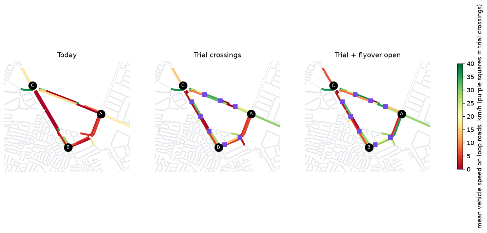
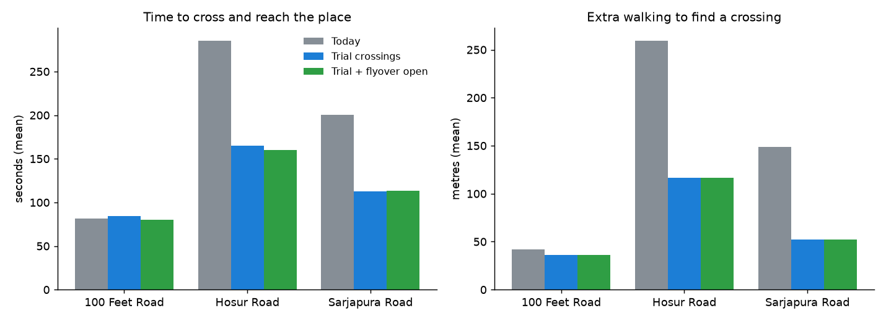
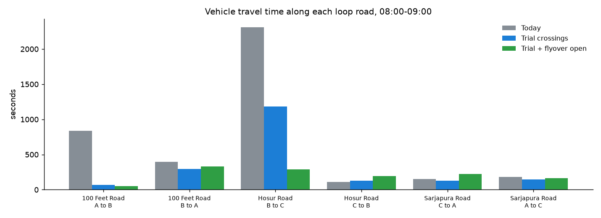

#+TITLE: Madiwala Loop Simulation
#+SUBTITLE: What the model simulates, what it shows, and how far to trust it
#+DATE: November 2026
#+OPTIONS: toc:t num:t author:nil
#+LANGUAGE: en
#+LATEX_CLASS: article
#+LATEX_CLASS_OPTIONS: [11pt,a4paper]
#+LATEX_HEADER: \usepackage[margin=2.2cm]{geometry}
#+LATEX_HEADER: \usepackage{parskip}
#+LATEX_HEADER: \usepackage{booktabs}
#+LATEX_HEADER: \usepackage{tabularx}
#+LATEX_HEADER: \usepackage[hidelinks]{hyperref}

* Summary

This repository contains a computer simulation of the Madiwala loop in Bengaluru: the triangle of
*100 Feet Road*, *Hosur Road* and *Sarjapura Road* between junctions A, B and C. It recreates a
weekday morning peak (8–9 am) with every vehicle, bus and pedestrian moving individually through a
model of the streets, and asks one question:

#+begin_quote
What changes for people on foot, and for traffic, if signalised pedestrian crossings are added
mid-block on the three loop roads?
#+end_quote

Three versions of the street are compared under identical demand:

#+ATTR_LATEX: :environment tabularx :width \textwidth :align lX
| Scenario             | What is different                                                                   |
|----------------------+-------------------------------------------------------------------------------------|
| Today (baseline)     | People can cross only at junctions and side-street mouths                           |
| Trial crossings      | Eight new signalised mid-block crossings at the positions proposed in the study     |
| Trial + flyover open | The trial crossings, with about half of the corridor's through traffic on the flyover |

*Main finding.* With the trial crossings, people crossing a loop road reach their destination about
*37% faster* and walk about *55% less extra distance* looking for a place to cross. The gain is
largest on Hosur Road and Sarjapura Road. Effects on traffic cannot yet be stated with confidence,
because traffic volumes are estimates (see [[*How far to trust the results][How far to trust the results]]).

* What is being simulated

** The place

The model covers the loop and a few hundred metres of the surrounding streets. The street network
is taken from OpenStreetMap and includes:

- every carriageway, with its number of lanes, direction and speed limit;
- left-hand traffic, and the underpass and flyover kept on separate levels from the roads below;
- footpaths along the roads and pedestrian crossings at junctions and side streets;
- traffic signals at junctions A, B and C;
- the bus stops on the loop, placed from the study's bus stop survey.

#+CAPTION: The loop in the three scenarios. Road colour shows average vehicle speed (red is slow, green is free-flowing); purple squares are the trial crossings.
#+ATTR_LATEX: :width \textwidth

** The people and vehicles

The model is an /agent-based/ simulation: each vehicle and each pedestrian is an individual with
its own origin, destination, speed and behaviour, rather than an averaged flow. Over the simulated
hour and a half (7:30–9:15 am, with the first half hour as warm-up) the model contains roughly:

- *14,000 vehicles*, in the mix measured in the corridor's origin–destination survey: 43%
  two-wheelers, 29% cars, 13% autos, and the remainder vans, goods autos, light commercial vehicles
  and trucks. Two-wheelers are allowed to filter between cars, approximating Bengaluru traffic.
- *About 500 real bus trips*, taken from the BMTC timetable, following their actual routes through
  the area and stopping at the loop's bus stops.
- *About 4,900 pedestrians*. Most are people who need to get across one of the loop roads to reach
  a specific place: a bus stop, the hospital, a college gate, a temple, a park, a side street.
  The rest are general walking along the footpaths.

** What the model measures

For each scenario the model records:

- *For people on foot:* time to reach their destination, time lost waiting at crossings, distance
  actually walked compared with the straight-line distance, and which crossings they used.
- *For traffic:* travel time and speed along each loop road in each direction, delay per vehicle,
  and queue lengths at junctions A, B, C and at each new crossing.
- *For buses:* delay per trip.
- *As checks on the model itself:* vehicles that got stuck and had to be moved on by the
  software, and collisions. Both should be rare.

* The scenarios in more detail

** Today (baseline)

People can cross where the street network already has a crossing: the signalised crossings at the
three junctions and the unsignalised crossings where side streets meet the main roads. In between,
a person who wants to reach the far side must walk to the nearest of these.

** Trial crossings

Eight signalised crossings are added mid-block, at the positions identified in the study's
analysis of crossing gaps and of the places people are trying to reach. Distances are measured
along each road from its first junction:

#+ATTR_LATEX: :environment tabularx :width \textwidth :align llX
| Road           | Crossing positions        | Notes                                                    |
|----------------+---------------------------+----------------------------------------------------------|
| 100 Feet Road  | 250 m, 410 m from A       | Only possible between 225 m and 438 m; the flyover ramp wall blocks 45–225 m |
| Hosur Road     | 175 m, 340 m, 500 m from B | 175 m serves the Ayyappa Temple bus stops                |
| Sarjapura Road | 210 m, 370 m, 520 m from C | 210 m serves the medical college gate                    |

Each crossing spans both carriageways of the divided road, and runs on a short, pedestrian-friendly
signal cycle of 75 seconds with 18 seconds of green for pedestrians.

** Trial crossings with the flyover open

The same crossings, with 53% of the through traffic between Inner Ring Road and Hosur Road (south)
moved onto the elevated corridor. The 53% is the midpoint of the 45–62% diversion estimated in the
corridor's origin–destination and toll study. This scenario indicates how much road capacity the
flyover could free up for the crossings.

* Results

All results are for trips starting between 8 and 9 am. The same people and vehicles are generated
in every scenario, so differences come from the street design rather than from chance.

** People crossing the loop roads

| Scenario             | People crossing | Average trip time | Average extra walking |
|----------------------+-----------------+-------------------+-----------------------|
| Today                |           2,647 | 194 s             | 156 m                 |
| Trial crossings      |           2,633 | 123 s             | 71 m                  |
| Trial + flyover open |           2,633 | 120 s             | 71 m                  |

/Extra walking/ is the distance walked beyond the straight line from origin to destination,
which is mostly the detour to reach a crossing.

| Road           | Today: time / extra walk | Trial: time / extra walk |
|----------------+--------------------------+--------------------------|
| 100 Feet Road  | 82 s / 42 m              | 85 s / 36 m              |
| Hosur Road     | 286 s / 260 m            | 165 s / 117 m            |
| Sarjapura Road | 201 s / 149 m            | 113 s / 52 m             |

Hosur Road gains the most: today, a person crossing it walks on average a quarter of a kilometre
out of their way. 100 Feet Road changes little, because the flyover ramp wall restricts where a
crossing can go, and the existing junction crossings already serve most destinations there.

#+CAPTION: Pedestrian trip time and extra walking, by road and scenario.
#+ATTR_LATEX: :width \textwidth

** Traffic and buses

| Scenario             | Vehicle delay per trip | Bus delay per trip | Vehicles unable to enter |
|----------------------+------------------------+--------------------+--------------------------|
| Today                | 734 s                  | 997 s              | 3,855                    |
| Trial crossings      | 657 s                  | 777 s              | 3,420                    |
| Trial + flyover open | 333 s                  | 342 s              | 576                      |

These figures should be read with caution. The traffic volumes used are estimates, and at these
volumes several thousand vehicles cannot even enter the area during the hour: the network is
saturated. Under saturation, delay figures mostly reflect which vehicles got in rather than the
effect of the street design. In particular, the apparent reduction in vehicle delay with the trial
crossings should not be taken as a finding; adding signals would not normally reduce delay.

What can be said with more confidence:

- The new crossings do create queues. The worst are at the 410 m crossing on 100 Feet Road and
  the 500 m crossing on Hosur Road, with average queues of around 80 m.
- Opening the flyover is the only scenario that clearly frees up road space, with large
  reductions in vehicle and bus delay.

#+CAPTION: Vehicle travel time along each loop road, by direction and scenario.
#+ATTR_LATEX: :width \textwidth

* How far to trust the results

** What comes from data

- Street layout, lanes, directions, speed limits and signal locations (OpenStreetMap).
- Bus routes and timetabled times (BMTC timetable data).
- Vehicle mix and flyover diversion share (corridor origin–destination and toll study).
- Locations of bus stops, crossing gaps and the places people cross to reach (this study).

** What is assumed

- *Traffic volumes* on each road. Only the 100 Feet Road corridor volume (about 1,150 vehicles
  per hour each way) is derived from survey data; the others are plausible estimates.
- *Signal timings* at A, B and C: fixed 120-second cycles generated by the software, not the real
  phasing.
- *Pedestrian numbers*: people crossing to each bus stop are estimated from the number of buses,
  passengers per bus and the share who cross; people crossing to other places are set per type of
  place (25–60 per hour).
- *Bus dwell time* of 20 seconds per stop.

All assumptions are kept in a single settings file so they can be replaced as counts come in.

** Known limits

- *No jaywalking.* Simulated people cross only at marked crossings. In reality many cross through
  gaps in traffic wherever they are. The model therefore overstates today's detours, and the
  benefit of the trial crossings is best read as an upper bound: the time saved for people who
  would use a crossing.
- *Uncalibrated traffic.* Until volumes and signal timings are matched to counts, absolute traffic
  numbers are indicative only. Comparisons between scenarios for pedestrians are more robust.
- *Approximate driving behaviour.* Lane-free driving and two-wheeler filtering are approximated,
  not reproduced exactly.
- *Network boundary.* The model ends a few hundred metres beyond the loop, so congestion
  beyond it is not represented.
- *Single run per scenario.* Small differences may be due to chance; repeated runs would be
  needed before relying on them.

* Making it more reliable: what the site walk should collect

#+ATTR_LATEX: :environment tabularx :width \textwidth :align lX
| Survey item                                         | Improves                                             |
|-----------------------------------------------------+------------------------------------------------------|
| Pedestrian crossing counts at the six survey points | Pedestrian numbers, and which crossings people use   |
| Turning counts at junctions A, B and C              | Traffic volumes; resolves the saturation problem     |
| Signal cycle and green times at A, B and C          | Junction delays and queues                           |
| Whether southbound buses run on Hosur Road (C to B) | Bus routes; the timetable data shows none            |
| Counts of people crossing mid-block, away from crossings | Size of the jaywalking effect the model leaves out |

Turning counts are the highest priority: they are what is needed to make the traffic results
credible.

* What else the model could test

Because the street network, the demand and the scenarios are kept separate, other proposals can be
added as further scenarios and compared against the same baseline, for example:

- different crossing positions or signal timings;
- narrowing 100 Feet Road once the flyover opens;
- footpath widening or removal of obstructions;
- a metro station, represented by the crowds walking to and from its exits and an assumed shift
  of trips from cars and two-wheelers.

* Data sources

- Street network: © OpenStreetMap contributors, Open Database Licence.
- Bus timetable: unofficial BMTC GTFS feed compiled from the Namma BMTC app, Open Database Licence.
- Vehicle mix and flyover diversion: origin–destination and toll analysis for the
  Indiranagar–Silk Board corridor.
- Crossing gaps, places people cross to reach, and bus stops: this study.
- Simulation software: SUMO (Simulation of Urban MObility), Eclipse Foundation, open source.
