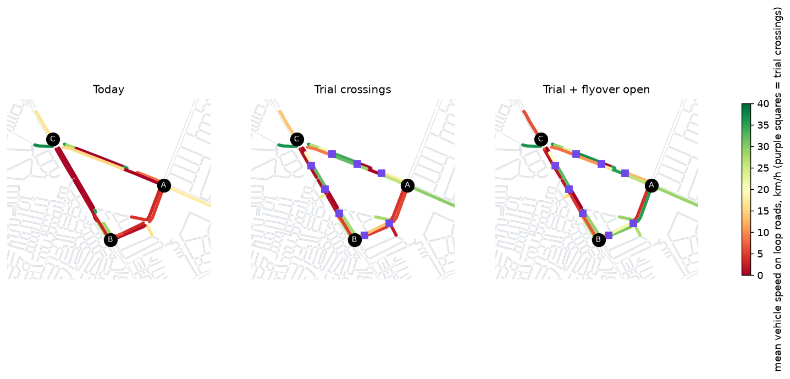

# Madiwala loop — SUMO traffic and pedestrian simulation

Weekday morning peak (metrics for trips starting 08:00–09:00; simulated 07:30–09:15 with warm-up),
same seeded demand in every scenario so differences come from the street changes.

**Read this first.** Road layout, signals, bus routes and bus times come from data (OpenStreetMap, BMTC GTFS). Traffic
volumes, pedestrian volumes and signal timings are **assumptions** until the site walk and counts replace them
(`config/assumptions.json`). Treat the numbers as a comparison between scenarios, not a forecast.

## Scenarios
- **Today (baseline)** — people can cross only where netconvert finds junction crossings (signalised at A, B, C; unsignalised at side-street mouths).
- **Trial crossings** — 8 signalised mid-block crossings (100 Feet Road: 250, 410 m, Hosur Road: 175, 340, 500 m, Sarjapura Road: 210, 370, 520 m from each road's first junction), 75 s cycle with 18 s pedestrian green.
- **Trial + flyover open** — as above, with 53% of corridor traffic (IRR>HS, HS>IRR, SE>HS, HS>SE) moved onto the elevated road.

## Headline results

| Scenario | People crossing (trips) | Crossing trip time, s (Δ vs today) | Extra walk, m (Δ) | Time lost walking, s (Δ) | Vehicle delay per trip incl. waiting to enter, s (Δ) | Bus delay per trip, s (Δ) | Vehicles never let in | Teleports | Collisions |
|---|---|---|---|---|---|---|---|---|---|
| Today | 2610 | 194.4 (+0.0) | 145.8 (+0.0) | 61.6 (+0.0) | 410.8 (+0.0) | 666.4 (+0.0) | 4224 | 367 | 13 |
| Trial crossings | 2609 | 141.6 (-52.8) | 95.3 (-50.5) | 45.9 (-15.7) | 562.4 (+151.6) | 629.4 (-37.0) | 3312 | 257 | 18 |
| Trial + flyover open | 2609 | 142.0 (-52.4) | 95.3 (-50.5) | 46.7 (-14.9) | 362.5 (-48.3) | 481.0 (-185.4) | 1309 | 117 | 21 |

*Vehicles never let in* = demand that could not enter the network before the simulation ended — a sign the assumed volumes exceed what the entries and signals can carry (Madiwala is congested at peak, but the volumes are uncalibrated).

### People crossing each road
| Scenario | Road | Trips | Trip time mean s | p85 s | Time lost s | Walked m | Straight-line m | Extra m | Detour factor (median) |
|---|---|---|---|---|---|---|---|---|---|
| Today | 100 Feet Road | 825 | 95.7 | 140.5 | 40.8 | 75.4 | 33.5 | 42.0 | 1.49 |
| Today | Hosur Road | 994 | 294.8 | 515.5 | 72.8 | 303.8 | 39.6 | 264.2 | 5.81 |
| Today | Sarjapura Road | 791 | 171.3 | 281.5 | 69.3 | 140.1 | 34.6 | 105.5 | 2.96 |
| Trial crossings | 100 Feet Road | 824 | 101.2 | 133.5 | 32.6 | 94.1 | 33.5 | 60.6 | 1.42 |
| Trial crossings | Hosur Road | 994 | 197.0 | 440.5 | 52.5 | 198.8 | 39.6 | 159.2 | 3.23 |
| Trial crossings | Sarjapura Road | 791 | 113.9 | 174.5 | 51.4 | 85.6 | 34.6 | 51.0 | 2.35 |
| Trial + flyover open | 100 Feet Road | 824 | 100.6 | 133.0 | 32.6 | 94.0 | 33.5 | 60.5 | 1.41 |
| Trial + flyover open | Hosur Road | 994 | 194.6 | 441.5 | 50.5 | 198.9 | 39.6 | 159.3 | 3.22 |
| Trial + flyover open | Sarjapura Road | 791 | 118.9 | 182.0 | 56.7 | 85.7 | 34.6 | 51.1 | 2.35 |

### Vehicles along each loop road

| Scenario | Road | Direction | Length m | Travel time s | Free-flow s | Delay s | Avg speed km/h | Vehicles/h (max edge) |
|---|---|---|---|---|---|---|---|---|
| Today | 100 Feet Road | A>B | 478 | 694.2 | 37.4 | 656.8 | 2.5 | 718 |
| Today | 100 Feet Road | B>A | 474 | 492.2 | 56.9 | 435.3 | 3.5 | 262 |
| Today | Hosur Road | B>C | 830 | 4497.8 | 65.2 | 4432.6 | 0.7 | 375 |
| Today | Hosur Road | C>B | 723 | 88.9 | 48.8 | 40.0 | 29.3 | 2263 |
| Today | Sarjapura Road | C>A | 750 | 148.6 | 51.3 | 97.3 | 18.2 | 2263 |
| Today | Sarjapura Road | A>C | 922 | 170.8 | 66.4 | 104.4 | 19.4 | 1247 |
| Trial crossings | 100 Feet Road | A>B | 463 | 395.1 | 36.3 | 358.8 | 4.2 | 758 |
| Trial crossings | 100 Feet Road | B>A | 460 | 241.2 | 55.2 | 185.9 | 6.9 | 390 |
| Trial crossings | Hosur Road | B>C | 820 | 1334.5 | 64.4 | 1270.1 | 2.2 | 552 |
| Trial crossings | Hosur Road | C>B | 790 | 128.1 | 57.5 | 70.6 | 22.2 | 2269 |
| Trial crossings | Sarjapura Road | C>A | 737 | 132.4 | 50.4 | 81.9 | 20.0 | 2269 |
| Trial crossings | Sarjapura Road | A>C | 910 | 150.9 | 65.5 | 85.4 | 21.7 | 1070 |
| Trial + flyover open | 100 Feet Road | A>B | 463 | 55.4 | 36.3 | 19.1 | 30.1 | 685 |
| Trial + flyover open | 100 Feet Road | B>A | 460 | 249.2 | 55.2 | 194.0 | 6.6 | 406 |
| Trial + flyover open | Hosur Road | B>C | 820 | 741.5 | 64.4 | 677.1 | 4.0 | 860 |
| Trial + flyover open | Hosur Road | C>B | 790 | 195.4 | 57.5 | 137.9 | 14.6 | 2285 |
| Trial + flyover open | Sarjapura Road | C>A | 737 | 212.7 | 50.4 | 162.3 | 12.5 | 2285 |
| Trial + flyover open | Sarjapura Road | A>C | 910 | 201.4 | 65.5 | 135.9 | 16.3 | 1157 |

### Queues at signals

| Scenario | Signal (A/B/C, X0-X7 = trial crossings) | Approach lanes | Mean queue, worst lane m | Max queue m |
|---|---|---|---|---|
| Today | A | 14 | 47.8 | 150.1 |
| Today | C | 12 | 50.0 | 149.9 |
| Trial crossings | A | 14 | 42.3 | 150.1 |
| Trial crossings | C | 12 | 84.0 | 150.1 |
| Trial crossings | X0 | 8 | 4.8 | 62.2 |
| Trial crossings | X1 | 8 | 48.3 | 139.0 |
| Trial crossings | X2 | 4 | 0.1 | 4.3 |
| Trial crossings | X3 | 14 | 17.3 | 47.7 |
| Trial crossings | X4 | 14 | 70.7 | 74.1 |
| Trial crossings | X5 | 12 | 2.9 | 48.6 |
| Trial crossings | X6 | 12 | 1.6 | 25.5 |
| Trial crossings | X7 | 12 | 5.0 | 133.4 |
| Trial + flyover open | A | 14 | 55.7 | 150.1 |
| Trial + flyover open | C | 12 | 132.6 | 150.1 |
| Trial + flyover open | X0 | 8 | 0.9 | 37.6 |
| Trial + flyover open | X1 | 8 | 3.2 | 54.5 |
| Trial + flyover open | X2 | 4 | 0.1 | 4.3 |
| Trial + flyover open | X3 | 14 | 16.4 | 42.9 |
| Trial + flyover open | X4 | 14 | 70.5 | 73.2 |
| Trial + flyover open | X5 | 12 | 56.8 | 150.1 |
| Trial + flyover open | X6 | 12 | 6.2 | 59.5 |
| Trial + flyover open | X7 | 12 | 3.6 | 139.4 |

Queue detectors cover the last 150 m of each approach lane, so 150 m means "the queue reaches past the detector".

### Crossing use (people per hour)
| Scenario | Crossing | People/h |
|---|---|---|
| Today | A | 1117 |
| Today | B | 1593 |
| Today | C | 1160 |
| Today | FOB BC@612 | 492 |
| Today | FOB CA@415 | 145 |
| Today | foot bridges off the loop | 4 |
| Today | other junctions | 5804 |
| Trial crossings | A | 1116 |
| Trial crossings | B | 642 |
| Trial crossings | C | 945 |
| Trial crossings | FOB BC@612 | 219 |
| Trial crossings | FOB CA@415 | 0 |
| Trial crossings | X0 | 12 |
| Trial crossings | X1 | 265 |
| Trial crossings | X2 | 240 |
| Trial crossings | X3 | 480 |
| Trial crossings | X4 | 108 |
| Trial crossings | X5 | 156 |
| Trial crossings | X6 | 38 |
| Trial crossings | X7 | 74 |
| Trial crossings | foot bridges off the loop | 4 |
| Trial crossings | other junctions | 5029 |
| Trial + flyover open | A | 1134 |
| Trial + flyover open | B | 630 |
| Trial + flyover open | C | 972 |
| Trial + flyover open | FOB BC@612 | 211 |
| Trial + flyover open | FOB CA@415 | 0 |
| Trial + flyover open | X0 | 12 |
| Trial + flyover open | X1 | 270 |
| Trial + flyover open | X2 | 244 |
| Trial + flyover open | X3 | 481 |
| Trial + flyover open | X4 | 109 |
| Trial + flyover open | X5 | 158 |
| Trial + flyover open | X6 | 38 |
| Trial + flyover open | X7 | 75 |
| Trial + flyover open | foot bridges off the loop | 5 |
| Trial + flyover open | other junctions | 5018 |

### Buses
| Scenario | Buses (finished) | Trip time in area s | Delay mean s | Delay p85 s |
|---|---|---|---|---|
| Today | 92 | 835.9 | 666.4 | 2056.6 |
| Trial crossings | 123 | 778.5 | 629.4 | 1432.6 |
| Trial + flyover open | 143 | 635.5 | 481.0 | 686.0 |

### Map

`results.geojson` holds per-edge speed / delay / volume for each loop road and scenario, plus the trial crossing points, ready for the website.

## Assumptions (all in `config/assumptions.json`)
| Item | Value | Status |
|---|---|---|
| Peak-hour vehicle flows between gateways | IRR>HS 1150, HS>IRR 1150, HN>HS 1500, HS>HN 1500, HN>SE 400, SE>HN 400, SE>HS 250, HS>SE 250, IRR>HN 200, HN>IRR 200, SE>TW 150, HS>TW 150, local_random 400, HN>TW 150 veh/h | ASSUMED (corridor ~1,150/dir derived from the OD study's 27,300/day) |
| Vehicle mix | 2W 11758, car 7968, van 1335, auto 3478, goods auto 480, LCV 1039, truck 262 (relative) | DATA (OD study) |
| Buses | real Monday trips from BMTC GTFS, dwell 20 s | DATA + ASSUMED dwell |
| Signals A, B, C | fixed time, 120 s cycle, programmes generated by netconvert | ASSUMED |
| Trial crossings | 75 s cycle, 18 s pedestrian green | proposal |
| People crossing | bus stops: buses in 8–9 am × 6 pax × 0.5 crossing; places: Healthcare 60/h, Institutional 60/h, Religious 25/h, Recreational 25/h, Public amenities 25/h, Side street 30/h; origins -60…60 m along the far footpath | ASSUMED |
| Background walking | 600 trips/h, 150–600 m | ASSUMED |
| Flyover diversion | 53% of corridor ODs | DATA-derived (OD/toll study, 45–62%) |
| Speeds | 50 km/h main roads, 40 km/h 100 Ft Rd, 30 km/h side streets, OSM maxspeed where tagged | ASSUMED / OSM |

## Limits — what this model cannot tell you
- **No jaywalking.** Simulated people only cross where the network has a crossing (junctions, side-street mouths, trial crossings). In reality people cross anywhere through gaps, so "today" understates how many people cross mid-block — and overstates their detours. The trial-crossing benefit is best read as *time and distance saved for people who use a crossing*.
- **Uncalibrated volumes.** Flows are plausible guesses; queues and delays scale with them. Calibrate before quoting absolute numbers.
- **Network cut at the edges.** The OSM extract ends close to the loop; the southern Hosur Rd exit is where southbound Hosur Rd meets Madiwala–Sarjapura Rd, and Tavarekere Main Rd is exit-only (one-way in OSM).
- **Signals** are netconvert-generated fixed-time plans, not the real phasing.
- **Two-wheeler behaviour** uses SUMO's sublane model (filtering between cars); Indian lane-free driving is only approximated.
- **Bus data** comes from the BMTC app, which has known timetable errors; it shows no southbound buses on Hosur Rd between C and B.
- Results are one seeded run per scenario; run several seeds before relying on small differences.

## Calibrating with the site walk
| Walk data (form section) | Replaces | Where |
|---|---|---|
| Crossing counts P1–P6 (§7) | `pedestrians.crossing_trips_per_hour_by_type` and the bus-stop share | scale rates so simulated crossings near each P-spot match the counts; check against `out/metrics/crossings_use.csv` |
| Turning counts at A, B, C (to add to the form) | `od_peak_veh_per_hour` | adjust OD flows until simulated edge counts (`results.geojson` `vehicles_per_h`) match |
| Signal cycle and green times at A, B, C (to add) | `signals.junction_*` | or write measured programmes into a tlLogic additional file |
| Bus direction check on Hosur Rd | GTFS assumption | if southbound buses exist, add them as extra trips |
| Footpath widths / blockages (§1) | — | narrow or remove sidewalk lanes in `net/` to test walkability |

Rebuild everything with `python run.py` after editing the config.
