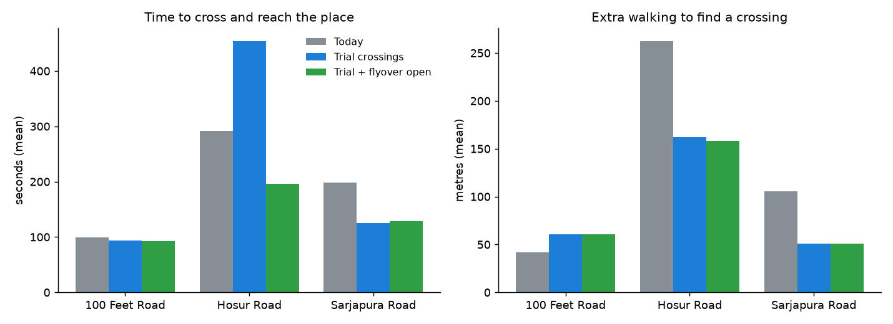
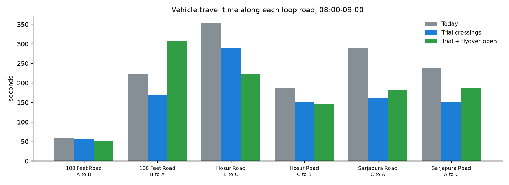
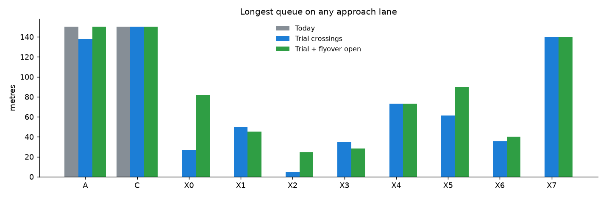

# Madiwala loop — SUMO traffic and pedestrian simulation

Weekday morning peak (metrics for trips starting 08:00–09:00; simulated 07:30–09:15 with warm-up),
same seeded demand in every scenario so differences come from the street changes.

**Read this first.** Road layout, signals, bus routes and bus times come from data (OpenStreetMap, BMTC GTFS). Traffic
volumes, pedestrian volumes and signal timings are **assumptions** until the site walk and counts replace them
(`config/assumptions.json`). Treat the numbers as a comparison between scenarios, not a forecast.

## Scenarios
- **Today (baseline)** — people can cross only where netconvert finds junction crossings (signalised at A, B, C; unsignalised at side-street mouths).
- **Trial crossings** — 8 signalised mid-block crossings (100 Feet Road: 250, 410 m, Hosur Road: 175, 340, 500 m, Sarjapura Road: 210, 370, 520 m from each road's first junction), 75 s cycle with 18 s pedestrian green.
- **Trial + flyover open** — as above, with 53% of corridor traffic (IRR>HS, HS>IRR, SE>HS, HS>SE) moved onto the elevated road.

## Headline results

| Scenario | People crossing (trips) | Crossing trip time, s (Δ vs today) | Extra walk, m (Δ) | Time lost walking, s (Δ) | Vehicle delay per trip incl. waiting to enter, s (Δ) | Bus delay per trip, s (Δ) | Vehicles never let in | Teleports | Collisions |
|---|---|---|---|---|---|---|---|---|---|
| Today | 2610 | 203.0 (+0.0) | 145.2 (+0.0) | 71.0 (+0.0) | 451.7 (+0.0) | 550.9 (+0.0) | 1567 | 198 | 15 |
| Trial crossings | 2557 | 236.4 (+33.4) | 95.1 (-50.1) | 140.8 (+69.8) | 587.4 (+135.7) | 802.2 (+251.3) | 2282 | 129 | 14 |
| Trial + flyover open | 2609 | 142.9 (-60.1) | 94.8 (-50.4) | 47.7 (-23.3) | 258.6 (-193.1) | 443.7 (-107.2) | 164 | 90 | 6 |

*Vehicles never let in* = demand that could not enter the network before the simulation ended — a sign the assumed volumes exceed what the entries and signals can carry (Madiwala is congested at peak, but the volumes are uncalibrated).

### People crossing each road
| Scenario | Road | Trips | Trip time mean s | p85 s | Time lost s | Walked m | Straight-line m | Extra m | Detour factor (median) |
|---|---|---|---|---|---|---|---|---|---|
| Today | 100 Feet Road | 825 | 99.7 | 153.0 | 44.6 | 75.5 | 33.5 | 42.0 | 1.5 |
| Today | Hosur Road | 994 | 292.4 | 500.5 | 72.6 | 302.3 | 39.6 | 262.7 | 5.79 |
| Today | Sarjapura Road | 791 | 198.5 | 310.0 | 96.6 | 139.9 | 34.6 | 105.3 | 2.96 |
| Trial crossings | 100 Feet Road | 824 | 93.7 | 123.5 | 25.5 | 94.0 | 33.5 | 60.5 | 1.42 |
| Trial crossings | Hosur Road | 942 | 454.4 | 900.5 | 307.3 | 202.1 | 39.7 | 162.4 | 3.27 |
| Trial crossings | Sarjapura Road | 791 | 125.3 | 190.0 | 62.6 | 85.7 | 34.6 | 51.0 | 2.35 |
| Trial + flyover open | 100 Feet Road | 824 | 92.9 | 120.5 | 24.8 | 94.1 | 33.5 | 60.6 | 1.42 |
| Trial + flyover open | Hosur Road | 994 | 195.7 | 439.5 | 51.7 | 197.6 | 39.6 | 158.0 | 3.2 |
| Trial + flyover open | Sarjapura Road | 791 | 128.5 | 196.5 | 66.5 | 85.6 | 34.6 | 51.0 | 2.35 |

### Vehicles along each loop road

| Scenario | Road | Direction | Length m | Travel time s | Free-flow s | Delay s | Avg speed km/h | Vehicles/h (max edge) |
|---|---|---|---|---|---|---|---|---|
| Today | 100 Feet Road | A>B | 478 | 59.0 | 37.4 | 21.7 | 29.2 | 1163 |
| Today | 100 Feet Road | B>A | 474 | 223.3 | 56.9 | 166.4 | 7.6 | 459 |
| Today | Hosur Road | B>C | 829 | 353.4 | 65.1 | 288.3 | 8.4 | 2158 |
| Today | Hosur Road | C>B | 725 | 186.7 | 49.1 | 137.6 | 14.0 | 2120 |
| Today | Sarjapura Road | C>A | 750 | 288.2 | 51.3 | 236.9 | 9.4 | 2120 |
| Today | Sarjapura Road | A>C | 922 | 238.8 | 66.4 | 172.4 | 13.9 | 918 |
| Trial crossings | 100 Feet Road | A>B | 463 | 55.3 | 36.3 | 19.0 | 30.1 | 861 |
| Trial crossings | 100 Feet Road | B>A | 460 | 167.8 | 55.2 | 112.5 | 9.9 | 366 |
| Trial crossings | Hosur Road | B>C | 819 | 289.4 | 64.4 | 225.0 | 10.2 | 1746 |
| Trial crossings | Hosur Road | C>B | 793 | 150.9 | 57.8 | 93.1 | 18.9 | 2318 |
| Trial crossings | Sarjapura Road | C>A | 737 | 161.8 | 50.4 | 111.4 | 16.4 | 2318 |
| Trial crossings | Sarjapura Road | A>C | 910 | 151.0 | 65.5 | 85.5 | 21.7 | 918 |
| Trial + flyover open | 100 Feet Road | A>B | 463 | 51.4 | 36.3 | 15.1 | 32.4 | 621 |
| Trial + flyover open | 100 Feet Road | B>A | 460 | 306.6 | 55.2 | 251.3 | 5.4 | 354 |
| Trial + flyover open | Hosur Road | B>C | 819 | 223.9 | 64.4 | 159.5 | 13.2 | 2066 |
| Trial + flyover open | Hosur Road | C>B | 793 | 145.0 | 57.8 | 87.2 | 19.7 | 2271 |
| Trial + flyover open | Sarjapura Road | C>A | 737 | 181.6 | 50.4 | 131.2 | 14.6 | 2271 |
| Trial + flyover open | Sarjapura Road | A>C | 910 | 187.5 | 65.5 | 122.0 | 17.5 | 795 |

### Queues at signals

| Scenario | Signal (A/B/C, X0-X7 = trial crossings) | Approach lanes | Mean queue, worst lane m | Max queue m |
|---|---|---|---|---|
| Today | A | 18 | 72.5 | 150.1 |
| Today | C | 20 | 88.8 | 150.1 |
| Trial crossings | A | 18 | 37.5 | 137.7 |
| Trial crossings | C | 20 | 60.5 | 150.1 |
| Trial crossings | X0 | 8 | 1.1 | 26.4 |
| Trial crossings | X1 | 8 | 3.6 | 49.8 |
| Trial crossings | X2 | 4 | 0.1 | 5.0 |
| Trial crossings | X3 | 14 | 4.3 | 35.0 |
| Trial crossings | X4 | 14 | 24.8 | 73.2 |
| Trial crossings | X5 | 12 | 2.4 | 61.4 |
| Trial crossings | X6 | 12 | 1.5 | 35.6 |
| Trial crossings | X7 | 12 | 3.9 | 139.4 |
| Trial + flyover open | A | 18 | 99.9 | 150.1 |
| Trial + flyover open | C | 20 | 69.6 | 150.1 |
| Trial + flyover open | X0 | 8 | 11.6 | 81.7 |
| Trial + flyover open | X1 | 8 | 3.2 | 45.4 |
| Trial + flyover open | X2 | 4 | 0.3 | 24.4 |
| Trial + flyover open | X3 | 14 | 3.2 | 28.2 |
| Trial + flyover open | X4 | 14 | 37.1 | 73.2 |
| Trial + flyover open | X5 | 12 | 8.7 | 89.7 |
| Trial + flyover open | X6 | 12 | 1.8 | 40.2 |
| Trial + flyover open | X7 | 12 | 3.9 | 139.4 |

Queue detectors cover the last 150 m of each approach lane, so 150 m means "the queue reaches past the detector".

### Crossing use (people per hour)
| Scenario | Crossing | People/h |
|---|---|---|
| Today | A | 1131 |
| Today | B | 1619 |
| Today | C | 1195 |
| Today | FOB BC@612 | 484 |
| Today | FOB CA@415 | 143 |
| Today | foot bridges off the loop | 8 |
| Today | other junctions | 11674 |
| Trial crossings | A | 1129 |
| Trial crossings | B | 679 |
| Trial crossings | C | 974 |
| Trial crossings | FOB BC@612 | 189 |
| Trial crossings | FOB CA@415 | 0 |
| Trial crossings | X0 | 14 |
| Trial crossings | X1 | 265 |
| Trial crossings | X2 | 237 |
| Trial crossings | X3 | 480 |
| Trial crossings | X4 | 107 |
| Trial crossings | X5 | 158 |
| Trial crossings | X6 | 39 |
| Trial crossings | X7 | 71 |
| Trial crossings | foot bridges off the loop | 7 |
| Trial crossings | other junctions | 9238 |
| Trial + flyover open | A | 1165 |
| Trial + flyover open | B | 681 |
| Trial + flyover open | C | 1006 |
| Trial + flyover open | FOB BC@612 | 196 |
| Trial + flyover open | FOB CA@415 | 0 |
| Trial + flyover open | X0 | 14 |
| Trial + flyover open | X1 | 261 |
| Trial + flyover open | X2 | 233 |
| Trial + flyover open | X3 | 479 |
| Trial + flyover open | X4 | 107 |
| Trial + flyover open | X5 | 156 |
| Trial + flyover open | X6 | 39 |
| Trial + flyover open | X7 | 73 |
| Trial + flyover open | foot bridges off the loop | 9 |
| Trial + flyover open | other junctions | 9398 |

### Buses
| Scenario | Buses (finished) | Trip time in area s | Delay mean s | Delay p85 s |
|---|---|---|---|---|
| Today | 195 | 717.1 | 550.9 | 1070.5 |
| Trial crossings | 174 | 958.3 | 802.2 | 1410.9 |
| Trial + flyover open | 218 | 615.7 | 443.7 | 683.7 |

### Map

`results.geojson` holds per-edge speed / delay / volume for each loop road and scenario, plus the trial crossing points, ready for the website.

## Assumptions (all in `config/assumptions.json`)
| Item | Value | Status |
|---|---|---|
| Peak-hour vehicle flows between gateways | IRR>HS 1150, HS>IRR 1150, HN>HS 1500, HS>HN 1500, HN>SE 400, SE>HN 400, SE>HS 250, HS>SE 250, IRR>HN 200, HN>IRR 200, SE>TW 150, HS>TW 150, local_random 400, HN>TW 150 veh/h | ASSUMED (corridor ~1,150/dir derived from the OD study's 27,300/day) |
| Vehicle mix | 2W 11758, car 7968, van 1335, auto 3478, goods auto 480, LCV 1039, truck 262 (relative) | DATA (OD study) |
| Buses | real Monday trips from BMTC GTFS, dwell 20 s | DATA + ASSUMED dwell |
| Signals A, B, C | fixed time, 120 s cycle, programmes generated by netconvert | ASSUMED |
| Trial crossings | 75 s cycle, 18 s pedestrian green | proposal |
| People crossing | bus stops: buses in 8–9 am × 6 pax × 0.5 crossing; places: Healthcare 60/h, Institutional 60/h, Religious 25/h, Recreational 25/h, Public amenities 25/h, Side street 30/h; origins -60…60 m along the far footpath | ASSUMED |
| Background walking | 600 trips/h, 150–600 m | ASSUMED |
| Flyover diversion | 53% of corridor ODs | DATA-derived (OD/toll study, 45–62%) |
| Speeds | 50 km/h main roads, 40 km/h 100 Ft Rd, 30 km/h side streets, OSM maxspeed where tagged | ASSUMED / OSM |

## Limits — what this model cannot tell you
- **No jaywalking.** Simulated people only cross where the network has a crossing (junctions, side-street mouths, trial crossings). In reality people cross anywhere through gaps, so "today" understates how many people cross mid-block — and overstates their detours. The trial-crossing benefit is best read as *time and distance saved for people who use a crossing*.
- **Uncalibrated volumes.** Flows are plausible guesses; queues and delays scale with them. Calibrate before quoting absolute numbers.
- **Network cut at the edges.** The OSM extract ends close to the loop; the southern Hosur Rd exit is where southbound Hosur Rd meets Madiwala–Sarjapura Rd, and Tavarekere Main Rd is exit-only (one-way in OSM).
- **Signals** are netconvert-generated fixed-time plans, not the real phasing.
- **Two-wheeler behaviour** uses SUMO's sublane model (filtering between cars); Indian lane-free driving is only approximated.
- **Bus data** comes from the BMTC app, which has known timetable errors; it shows no southbound buses on Hosur Rd between C and B.
- Results are one seeded run per scenario; run several seeds before relying on small differences.

## Calibrating with the site walk
| Walk data (form section) | Replaces | Where |
|---|---|---|
| Crossing counts P1–P6 (§7) | `pedestrians.crossing_trips_per_hour_by_type` and the bus-stop share | scale rates so simulated crossings near each P-spot match the counts; check against `out/metrics/crossings_use.csv` |
| Turning counts at A, B, C (to add to the form) | `od_peak_veh_per_hour` | adjust OD flows until simulated edge counts (`results.geojson` `vehicles_per_h`) match |
| Signal cycle and green times at A, B, C (to add) | `signals.junction_*` | or write measured programmes into a tlLogic additional file |
| Bus direction check on Hosur Rd | GTFS assumption | if southbound buses exist, add them as extra trips |
| Footpath widths / blockages (§1) | — | narrow or remove sidewalk lanes in `net/` to test walkability |

Rebuild everything with `python run.py` after editing the config.
