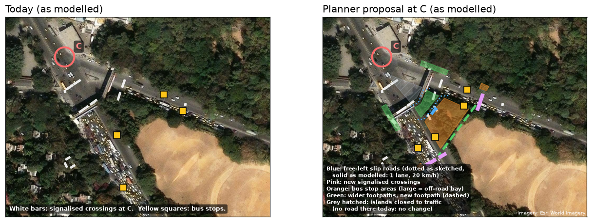
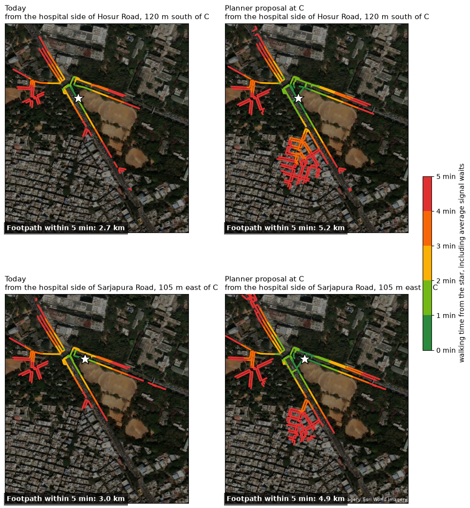
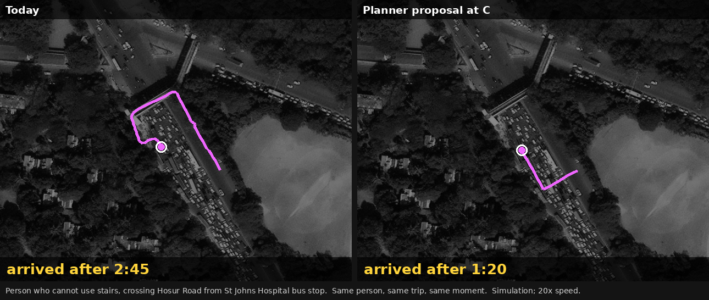
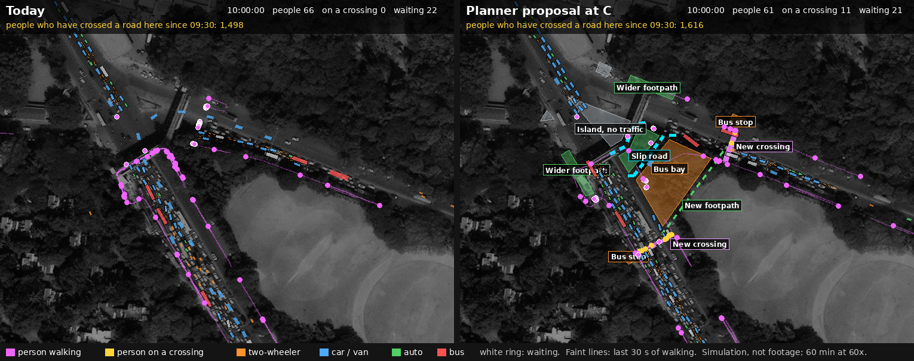

# Junction C proposal test

Madiwala loop model, weekday 9:30–10:30 am. Today and the proposal: ten runs each; variants: five. Drawing: `151126-231655-proposal.geojson`. The videos are in the same folder as this report; `index.html` shows everything together.

> **In short:** the proposal shortens the walk to cross both roads near C: about 40 m less on Hosur Road, 20 m less on Sarjapura Road. Crossing Sarjapura Road takes a minute less. On Hosur Road the time gain is small, because people now wait at the new signal instead of walking to C. From the hospital side of either road, the footpath you can reach in five minutes almost doubles. Almost all of this comes from the two new signalised crossings. Vehicle results point the other way but are not calibrated yet.

# What was tested

Today's network and traffic, plus the drawing: two new signalised crossings (Sarjapura Road about 105 m from C, Hosur Road about 120 m south of C), a free-left slip road from Sarjapura Road onto Hosur Road towards B, an off-road bus bay and two moved St John's bus stops, wider footpaths, and a new footpath across the corner.

Two variants show what drives the result: the proposal **without the new crossings**, and the proposal with **crossings that favour traffic** (vehicles keep the green while traffic keeps coming, 20–90 s, then people get 18 s).

# Pedestrian results

Typical run of ten.

<table border="2" cellspacing="0" cellpadding="6" rules="groups" frame="hsides">

<colgroup>
<col  class="org-left" />

<col  class="org-left" />

<col  class="org-left" />

<col  class="org-left" />
</colgroup>
<thead>
<tr>
<th scope="col" class="org-left">Crossing</th>
<th scope="col" class="org-left">Today</th>
<th scope="col" class="org-left">Proposal</th>
<th scope="col" class="org-left">Crossings favour traffic</th>
</tr>
</thead>
<tbody>
<tr>
<td class="org-left">Hosur Road: extra walk to reach a crossing</td>
<td class="org-left">260 m</td>
<td class="org-left"><b>217 m</b></td>
<td class="org-left">217 m</td>
</tr>

<tr>
<td class="org-left">Hosur Road: time to cross and reach the place</td>
<td class="org-left">5.0 min</td>
<td class="org-left"><b>4.7 min</b></td>
<td class="org-left">4.8 min</td>
</tr>

<tr>
<td class="org-left">Sarjapura Road: extra walk</td>
<td class="org-left">106 m</td>
<td class="org-left"><b>84 m</b></td>
<td class="org-left">84 m</td>
</tr>

<tr>
<td class="org-left">Sarjapura Road: time to cross and reach the place</td>
<td class="org-left">3.2 min</td>
<td class="org-left"><b>2.2 min</b></td>
<td class="org-left">2.3 min</td>
</tr>

<tr>
<td class="org-left">People who cannot use stairs: Hosur Road extra walk</td>
<td class="org-left">245 m</td>
<td class="org-left"><b>208 m</b></td>
<td class="org-left">206 m</td>
</tr>

<tr>
<td class="org-left">People who cannot use stairs: Sarjapura Road time</td>
<td class="org-left">3.3 min</td>
<td class="org-left"><b>2.3 min</b></td>
<td class="org-left">2.4 min</td>
</tr>

<tr>
<td class="org-left">100 Feet Road: extra walk</td>
<td class="org-left">42 m</td>
<td class="org-left">42 m</td>
<td class="org-left">42 m</td>
</tr>
</tbody>
</table>

-   **The new crossings are used heavily:** about 930 people an hour on the Hosur Road one and 430 on the Sarjapura Road one. Most of them used to cross at C.
-   **Hosur Road gains distance more than time:** people walk 43 m less but wait at the new signal (18 s of green in a 75 s cycle). Today's Hosur Road is also less predictable: across ten runs it took 4.8 to 9.8 minutes, the proposal 4.6 to 5.0.
-   **People who cannot use stairs** (1 in 10 in the model) gain the same distance; on Sarjapura Road they save a minute; on Hosur Road their time barely changes.
-   **Without the new crossings** the walks are as long as today or slightly longer (Hosur 253 m, Sarjapura 114 m): the gains come from the crossings. Crowds then build at the foot over bridge stairs at C, which the model exaggerates, so that variant's times are not shown.
-   **More waiting at signals:** in one recorded hour, people spent 1,341 person-minutes standing still near C with the proposal, against 1,042 today. The waiting moves from the foot over bridge stairs to the new crossings.

From the hospital side of Hosur Road, the footpath within five minutes grows from 2.7 km to 5.2 km; from the hospital side of Sarjapura Road, from 3.0 km to 4.9 km. The new crossing opens up the streets across the road.

.")

# Three people, followed

The same person on the same trip in both runs, side by side. Picked as typical: the time saved closest to the median for their kind of trip. Videos: `follow_1.mp4`, `follow_2.mp4`, `follow_3.mp4`.

<table border="2" cellspacing="0" cellpadding="6" rules="groups" frame="hsides">

<colgroup>
<col  class="org-left" />

<col  class="org-right" />

<col  class="org-right" />
</colgroup>
<thead>
<tr>
<th scope="col" class="org-left">Who</th>
<th scope="col" class="org-right">Today</th>
<th scope="col" class="org-right">Proposal</th>
</tr>
</thead>
<tbody>
<tr>
<td class="org-left">Bus passenger at the St John's Hospital stop, crossing Hosur Road</td>
<td class="org-right">3:02</td>
<td class="org-right">2:09</td>
</tr>

<tr>
<td class="org-left">Bus passenger at the St John's Hospital stop, crossing Sarjapura Road</td>
<td class="org-right">3:26</td>
<td class="org-right">1:24</td>
</tr>

<tr>
<td class="org-left">Someone who cannot use stairs, crossing Hosur Road from the same stop</td>
<td class="org-right">2:45</td>
<td class="org-right">1:20</td>
</tr>
</tbody>
</table>

# The whole hour

Videos: `hour_C.mp4` (junction C) and `hour_loop.mp4` (whole loop), 9:30–10:30 at 60× speed, with a running count of people who have crossed. `clip_C.mp4` and `clip_loop.mp4` show two minutes at 8×. Pink dots are people walking, yellow are people on a crossing; the proposal's changes are labelled on the map.

# Vehicles: direction only

**The vehicle side is not calibrated.** No traffic has been counted on the loop and there are no turning counts at C, so read these as direction, not as measured losses.

In the model the proposal slows Hosur Road towards C in every run, and vehicle and bus delays rise in most runs. Queues from the two new crossings reach back towards C and A. The slip road carries no traffic even when drivers choose routes from current travel times: no modelled traffic needs that turn. That reflects missing data, not the design.

# Assumptions

## Pedestrians (the results above rely on these)

<table border="2" cellspacing="0" cellpadding="6" rules="groups" frame="hsides">

<colgroup>
<col  class="org-left" />

<col  class="org-left" />

<col  class="org-left" />
</colgroup>
<thead>
<tr>
<th scope="col" class="org-left">What</th>
<th scope="col" class="org-left">Assumed</th>
<th scope="col" class="org-left">Source</th>
</tr>
</thead>
<tbody>
<tr>
<td class="org-left">Who crosses</td>
<td class="org-left">Bus passengers (6 get on or off per bus, half cross), plus people going to hospitals and schools (60 an hour each), temples, parks and amenities (25), side streets (30), and 600 background walks an hour</td>
<td class="org-left">Our estimate; no counts</td>
</tr>

<tr>
<td class="org-left">Where they start and end</td>
<td class="org-left">Within 60 m either side of each place, on the far side of the road</td>
<td class="org-left">Our estimate</td>
</tr>

<tr>
<td class="org-left">Walking speed</td>
<td class="org-left">1.2 m/s; foot over bridge stairs 0.5 m/s</td>
<td class="org-left">Standard values</td>
</tr>

<tr>
<td class="org-left">People who cannot use stairs</td>
<td class="org-left">1 in 10 (wheelchairs, prams, many older people); they never use foot over bridges and walk at 1.0 m/s</td>
<td class="org-left">Planning allowance; no local figure</td>
</tr>

<tr>
<td class="org-left">Where people cross</td>
<td class="org-left">Only at crossings and foot over bridges, and only on the green. Crossing on red in gaps is not modelled: the simulator's ways of allowing it sent people into moving traffic. Detours and waits are an upper bound</td>
<td class="org-left">Model limit</td>
</tr>

<tr>
<td class="org-left">Footpaths</td>
<td class="org-left">Along every road OpenStreetMap shows; widths guessed</td>
<td class="org-left">OpenStreetMap</td>
</tr>

<tr>
<td class="org-left">Buses</td>
<td class="org-left">BMTC timetable for the hour; 20 s at each stop</td>
<td class="org-left">Unofficial feed; stop time assumed</td>
</tr>
</tbody>
</table>

## How the drawing was read

<table border="2" cellspacing="0" cellpadding="6" rules="groups" frame="hsides">

<colgroup>
<col  class="org-left" />

<col  class="org-left" />
</colgroup>
<thead>
<tr>
<th scope="col" class="org-left">Drawn</th>
<th scope="col" class="org-left">Modelled as</th>
</tr>
</thead>
<tbody>
<tr>
<td class="org-left">Zebra crossings (6)</td>
<td class="org-left">Signalised, fixed 75 s cycle with 18 s for people. Four sit on C's own arms, which already have crossings, so two are new.</td>
</tr>

<tr>
<td class="org-left">New roads (2)</td>
<td class="org-left">One two-lane free-left slip road from Sarjapura Road onto Hosur Road towards B, at 20 km/h. The sketch stops short of the roads, so it joins the nearest ones; the link is only 8 m long because the two carriageways meet beside C.</td>
</tr>

<tr>
<td class="org-left">Zone 1</td>
<td class="org-left">Islands closed to traffic. No road runs there today, so nothing changes.</td>
</tr>

<tr>
<td class="org-left">Zone 2</td>
<td class="org-left">Footpaths widened to 4 m.</td>
</tr>

<tr>
<td class="org-left">Zone 3</td>
<td class="org-left">Bus stops. The large shape is an off-road bay for the Sarjapura Road stop; the small ones move two St John's stops next to the new crossings.</td>
</tr>

<tr>
<td class="org-left">New footpath</td>
<td class="org-left">A 70 m walkway across the corner.</td>
</tr>
</tbody>
</table>

## Traffic (not relied on)

<table border="2" cellspacing="0" cellpadding="6" rules="groups" frame="hsides">

<colgroup>
<col  class="org-left" />

<col  class="org-left" />

<col  class="org-left" />
</colgroup>
<thead>
<tr>
<th scope="col" class="org-left">What</th>
<th scope="col" class="org-left">Assumed</th>
<th scope="col" class="org-left">Source</th>
</tr>
</thead>
<tbody>
<tr>
<td class="org-left">Vehicle volumes</td>
<td class="org-left">12 flows between the loop's entry roads, 200–1,500 vehicles an hour each, plus 400 local trips</td>
<td class="org-left">Our estimate; one flow from a count 6 km north</td>
</tr>

<tr>
<td class="org-left">Hour</td>
<td class="org-left">9:30–10:30 am, but volumes not raised for it</td>
<td class="org-left">Published counts peak then</td>
</tr>

<tr>
<td class="org-left">Vehicle mix</td>
<td class="org-left">Two-wheelers 45%, cars 30%, autos 13%, the rest vans, goods vehicles and trucks</td>
<td class="org-left">Indiranagar–Domlur count, 2025</td>
</tr>

<tr>
<td class="org-left">Signals</td>
<td class="org-left">A and C adjust green to the queues (8–60 s); B has no signal</td>
<td class="org-left">A, C assumed; B from drawings</td>
</tr>

<tr>
<td class="org-left">Routes</td>
<td class="org-left">Each driver picks a route when setting off, from recent travel times; buses keep theirs. Changing route on the way crashes the simulator on this network</td>
<td class="org-left">Model setting</td>
</tr>

<tr>
<td class="org-left">Lanes</td>
<td class="org-left">From OpenStreetMap, plus two-lane slip roads at B</td>
<td class="org-left">Map, corrected by us</td>
</tr>
</tbody>
</table>

# Making the model better

1.  **Turning counts at A, B and C** for the peak hour, by vehicle type. This settles whether the slip road matters.
2.  **Pedestrian counts at each crossing and where people cross informally**, with wait times. This replaces our largest pedestrian estimate.
3.  **How many people cross on red, and when.** The simulator cannot yet do this realistically; counts would show how much shorter real detours are.
4.  **Signal timings at A and C**, and what actually happens at B.
5.  **Vehicles cleared per green** on the busiest approaches, and usable road width.
6.  **Travel times around the loop**, three runs each way, to check the model against the street.
7.  **Bus stop times at the St John's stops**, and how much of the lane a stopped bus blocks.
8.  **The planner's notes on the drawing:** what each zone is, and the crossing type.
9.  **Foot over bridge stair widths**, measured on the walk, so crowding there is not exaggerated.
10. **Raise traffic volumes for 9:30–10:30** once the counts exist.

Simulated with SUMO on the OpenStreetMap network. Bus timetable: unofficial BMTC feed. Imagery: Esri World Imagery. Every setting is in the model's `config/assumptions.json`, marked as assumed or data.

