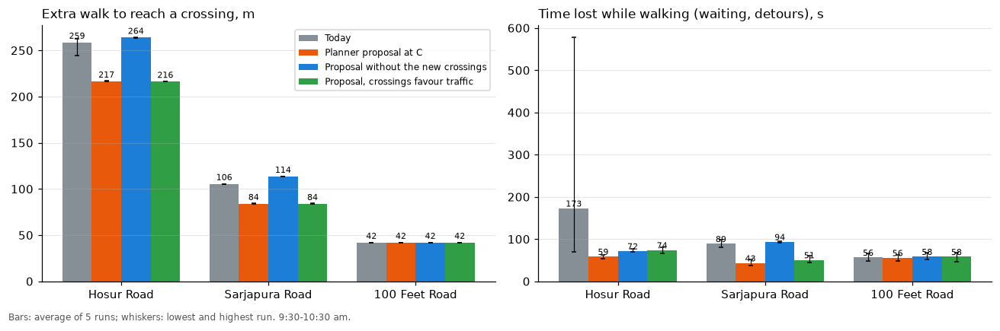
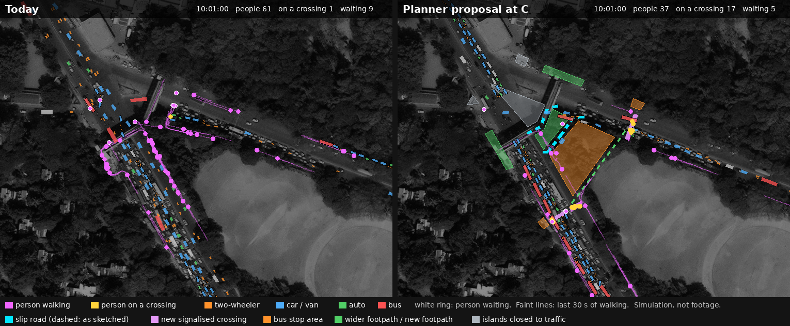
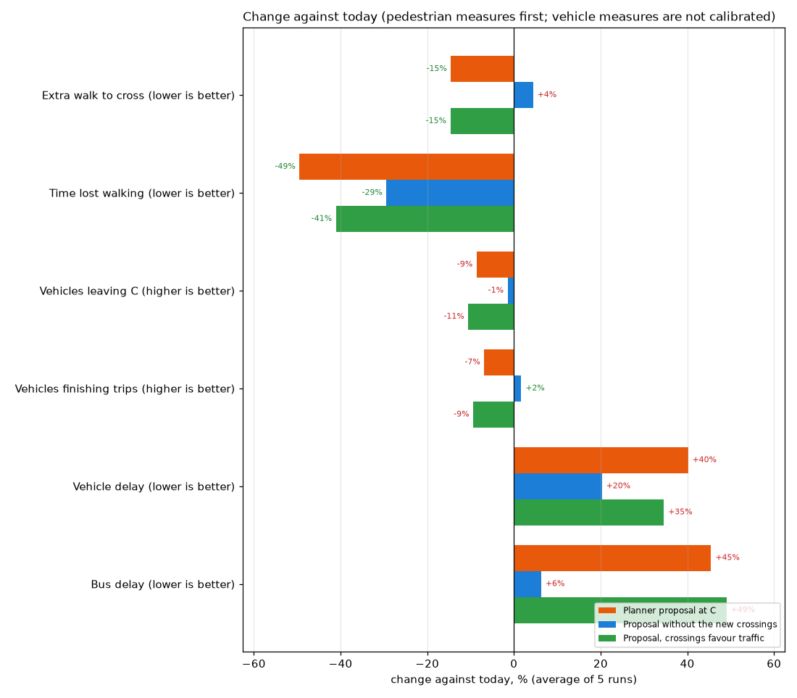

# Planner proposal at junction C: simulation result

*Madiwala loop model, weekday 9:30–10:30 am, five runs of each version. Drawing: `151126-231655-proposal.geojson`.*

**In short:** the proposal makes crossing the roads near C clearly easier on foot. People walk about 40 m less to cross Hosur Road and 20 m less to cross Sarjapura Road, and lose about half as much time on Sarjapura Road. Almost all of that comes from the two new signalised crossings. Vehicle results point the other way but aren't calibrated yet (see the caveat).

## What was tested

Today's network and traffic, plus the drawing: two new signalised crossings (Sarjapura Road about 105 m from C, Hosur Road about 120 m south of C), a free-left slip road from Sarjapura Road onto Hosur Road towards B, an off-road bus bay and two moved St John's bus stops, wider footpaths, and a new footpath across the corner. How each mark was read is listed under assumptions.

Two variants show what drives the result:
- **Without the new crossings:** everything else in the drawing.
- **Crossings favour traffic:** the new crossings hold green for vehicles while traffic keeps coming (20–90 s), then give people 18 s.

## Pedestrian results

| Crossing… | Today | Proposal | Without new crossings | Crossings favour traffic |
|---|---|---|---|---|
| Hosur Road: extra walk to reach a crossing | 259 m | **217 m** | 264 m | 216 m |
| Hosur Road: time to cross and reach the place (typical run) | 4.9 min | **4.1 min** | 4.9 min | 4.3 min |
| Sarjapura Road: extra walk | 106 m | **84 m** | 114 m | 84 m |
| Sarjapura Road: time to cross and reach the place | 3.2 min | **2.2 min** | 3.4 min | 2.3 min |
| 100 Feet Road: extra walk | 42 m | 42 m | 42 m | 42 m |

- **The new crossings are used heavily:** about 920 people an hour on the Hosur Road one and 430 on the Sarjapura Road one. Most come from C, whose crossings drop from about 1,180 to 260 people an hour.
- **The gains come from the crossings.** Without them, walking gets slightly longer: the slip road adds one more road to cross at the corner.
- **Letting traffic go first keeps most of the gain:** people lose 8–15 s more per crossing than in the plain proposal.
- **One of today's five runs jammed** and left people stuck on Hosur Road (10 minutes lost on average in that run). The table uses the typical run there.

## Before and after in the simulation

Same moment (10:01 am), same traffic. Videos: [`clip_C.mp4`](clip_C.mp4) (junction C) and [`clip_loop.mp4`](clip_loop.mp4) (whole loop), 2 minutes at 8× speed.

## Vehicle results (direction only)

In the model the proposal slows Sarjapura Road towards C, Hosur Road in both directions and 100 Feet Road towards B, in all five runs. Queues from the two new crossings reach back to C and A. The slip road carries almost nothing, because almost no modelled traffic turns from Sarjapura Road towards B. Read this as "the crossings cost vehicle time", not as a measured loss.

## Assumptions

**Pedestrians** (the results this report relies on)

| What | Assumed | Source |
|---|---|---|
| Who crosses | Bus passengers (6 get on or off per bus, half of them cross), plus people going to hospitals, schools (60 an hour each), temples, parks, amenities (25) and side streets (30), and 600 background walks an hour | Our estimate; no counts yet |
| Where they start and end | Within 60 m either side of each place, on the far side of the road | Our estimate |
| Walking speed | 1.2 m/s; foot over bridge stairs 0.5 m/s | Standard values |
| Where people can cross | Only at crossings and foot over bridges; nobody crosses through traffic | Model limit: real people do, so detours are an upper bound |
| Footpaths | Wherever OpenStreetMap has a road; widths guessed | OpenStreetMap |
| Bus stops and buses | BMTC timetable for the hour (unofficial feed); 20 s at each stop | Timetable data; dwell assumed |

**The proposal** (a sketch, so each mark had to be read)

| Drawn | Modelled as |
|---|---|
| Zebra crossings | Signalised; fixed 75 s cycle with 18 s for people. Four were on C's arms, which already have crossings, so only two are new |
| New roads (2) | One two-lane free-left slip road from Sarjapura Road onto Hosur Road towards B, 20 km/h. The sketch stops short of the roads, so it joins the nearest ones; the link is only 8 m long because the two carriageways meet beside C. It mainly lets left-turners skip C's signal |
| Zone 1 | Islands closed to traffic: no road runs there today, so no change |
| Zone 2 | Footpaths widened to 4 m |
| Zone 3 | Bus stops: the large shape is an off-road bay for the Sarjapura Road stop; the small ones move two St John's stops next to the new crossings |
| New footpath | 70 m walkway across the corner |

**Traffic** (not relied on; see the caveat)

| What | Assumed | Source |
|---|---|---|
| Vehicle volumes | 12 flows between the loop's entry roads, 200 to 1,500 vehicles an hour each, plus 400 local trips | Our estimate; one flow borrowed from a count 6 km north |
| Hour | 9:30-10:30 am, but volumes not raised for it | Published counts peak then |
| Vehicle mix | Two-wheelers 45%, cars 30%, autos 13%, the rest vans, goods vehicles and trucks | Indiranagar-Domlur count, April 2025 |
| Signals | A and C adjust green to the queues (8-60 s); B has no signal | Assumed for A and C; B from official drawings |
| Routes | Each vehicle picks the shortest route at the start and keeps it | Model setting |
| Lanes | From OpenStreetMap, plus 2-lane slip roads at B | Map, corrected by us |

## Caveat: vehicle results

The vehicle side is not calibrated, so read its numbers as direction only.

- **No traffic has been counted on the loop.** Volumes are estimates, and the jam they create at B spreads to the rest of the loop.
- **No turning counts at C.** The slip road's value depends on how many vehicles turn from Sarjapura Road towards B. In the model almost none do, so it barely changes anything. That is a gap in the data, not a finding about the design.
- **Fixed routes.** Drivers don't switch to the slip road or avoid a new queue, as real drivers would.
- **Vehicle results swing by about a quarter between runs.** Only changes that held in all five runs are reported as gains or losses.

## Making the model better

In order of value:

1. **Turning counts at A, B and C** for the peak hour, by vehicle type: settles whether the slip road matters.
2. **Pedestrian counts at each crossing and at the places people cross informally**, with wait times: replaces our largest pedestrian estimate.
3. **Signal timings at A and C**, and what happens at B (police, free-for-all).
4. **Vehicles cleared per green** at the busiest approaches, and usable road width: calibrates capacity.
5. **Travel times around the loop**, three runs each way: checks the model against the street.
6. **Bus dwell times at the St John's stops**, and how far buses block the lane.
7. **The planner's notes on the drawing**: what each zone is, and the crossing type.
8. **Let drivers reroute** once counts exist, so new links and new queues change routes.
9. **Raise volumes for 9:30-10:30** once the counts exist.

Model files: `config/assumptions.json` (every setting, marked assumed or data), `out/checks/proposal_151126.txt` (how each drawn mark was applied), `out/metrics/compare_baseline_proposal_151126.csv` (all measures, all runs).
