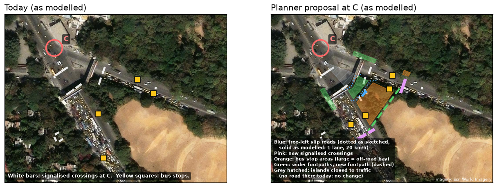
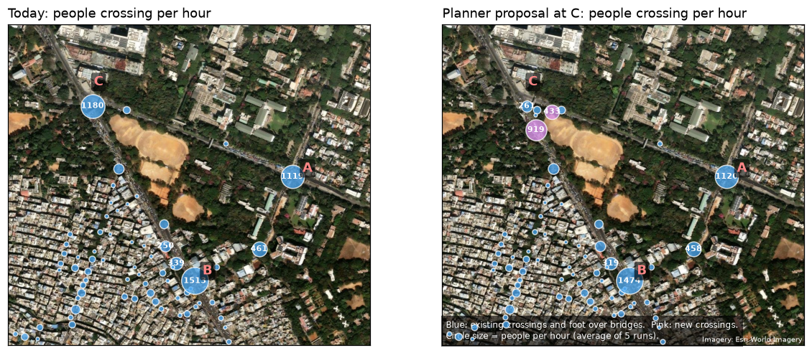
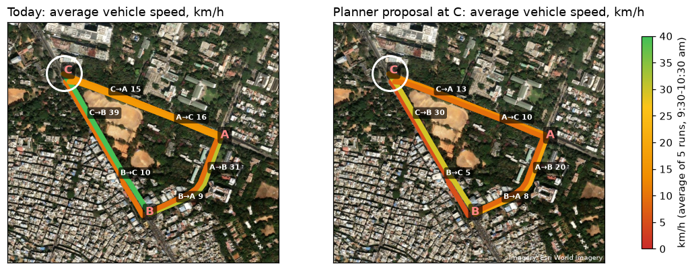

#+TITLE: Junction C proposal test
#+SUBTITLE: The planner's drawing for junction C, simulated against today's Madiwala loop
#+DATE: 16 November 2026
#+OPTIONS: toc:nil num:nil author:nil
#+LANGUAGE: en
#+LATEX_CLASS: article
#+LATEX_CLASS_OPTIONS: [11pt,a4paper]
#+LATEX_HEADER: \usepackage[margin=2cm]{geometry}
#+LATEX_HEADER: \usepackage{parskip}
#+LATEX_HEADER: \usepackage{booktabs}
#+LATEX_HEADER: \usepackage{tabularx}
#+LATEX_HEADER: \usepackage{newunicodechar}\newunicodechar{×}{\ensuremath{\times}}
#+LATEX_HEADER: \usepackage[scaled]{helvet}\renewcommand{\familydefault}{\sfdefault}
#+LATEX_HEADER: \AtBeginDocument{\hypersetup{hidelinks}}

/Madiwala loop model, weekday 9:30–10:30 am, five runs of each version. Drawing: =151126-231655-proposal.geojson=. Online version with videos: https://claude.ai/artifact/X5gRyrz24H2JZVpMo9cJQp/

#+begin_quote
*In short:* the proposal makes crossing near C clearly easier on foot. People walk about 40 m less to cross Hosur Road and 20 m less to cross Sarjapura Road, and crossing Sarjapura Road takes a minute less. Almost all of it comes from the two new signalised crossings. The vehicle results point the other way but are not calibrated yet.
#+end_quote

* What was tested

Today's network and traffic, plus the drawing: two new signalised crossings (Sarjapura Road about 105 m from C, Hosur Road about 120 m south of C), a free-left slip road from Sarjapura Road onto Hosur Road towards B, an off-road bus bay and two moved St John's bus stops, wider footpaths, and a new footpath across the corner.

#+CAPTION: Junction C as modelled, today and with the proposal. Imagery: Esri World Imagery.
#+ATTR_LATEX: :width \textwidth

Two variants show what drives the result: the proposal *without the new crossings*, and the proposal with *crossings that favour traffic* (vehicles keep the green while traffic keeps coming, 20–90 s, then people get 18 s).

* Pedestrian results

#+ATTR_LATEX: :environment tabularx :width \textwidth :align Xrrrr
| Crossing                                          | Today   | Proposal  | Without new crossings | Crossings favour traffic |
|---------------------------------------------------+---------+-----------+-----------------------+--------------------------|
| Hosur Road: extra walk to reach a crossing        | 259 m   | *217 m*   | 264 m                 | 216 m                    |
| Hosur Road: time to cross and reach the place     | 4.9 min | *4.1 min* | 4.9 min               | 4.3 min                  |
| Sarjapura Road: extra walk                        | 106 m   | *84 m*    | 114 m                 | 84 m                     |
| Sarjapura Road: time to cross and reach the place | 3.2 min | *2.2 min* | 3.4 min               | 2.3 min                  |
| 100 Feet Road: extra walk                         | 42 m    | 42 m      | 42 m                  | 42 m                     |

- *The new crossings are used heavily:* about 920 people an hour on the Hosur Road one and 430 on the Sarjapura Road one. Most of them used to cross at C, where use drops from about 1,180 to 260 an hour.
- *The gains come from the crossings.* Without them, walking gets slightly longer, because the slip road adds one more road to cross at the corner.
- *Letting traffic go first keeps most of the gain:* people lose 8–15 s more per crossing than in the plain proposal.
- *Today is less predictable:* one of the five runs of today jammed and left people stuck on Hosur Road. The table uses the typical run there.

#+CAPTION: Extra walk and time lost per road. Average of five runs; whiskers show the lowest and highest run.
#+ATTR_LATEX: :width \textwidth
[[file:walking.png]]

#+CAPTION: People crossing per hour at each crossing. Blue: existing crossings and foot over bridges. Pink: the two new crossings.
#+ATTR_LATEX: :width \textwidth

* Before and after in the simulation

The same moment (10:01 am) with the same traffic, today on the left and the proposal on the right. Simulated, not footage: the grey photo underneath is only for orientation. Two-minute videos at 8× speed: =clip_C.mp4= (junction C) and =clip_loop.mp4= (whole loop), in this folder and on the online version.

- *Today:* a stream of people walks up the Hosur Road footpaths to C and bunches at its crossings. Their faint trails show the detour.
- *Proposal:* people cross at the two new crossings (yellow dots on the pink bars) and the walk up to C mostly disappears.
- *Traffic:* queues stand behind the new crossings, especially on Hosur Road towards C. The slip road stays almost empty; see below.

#+CAPTION: Junction C at 10:01 am. Pink: people walking; yellow: people on a crossing; blue: cars; orange: two-wheelers; red: buses.
#+ATTR_LATEX: :width \textwidth
[[file:still_C.png]]

* Vehicles: direction only

*The vehicle side is not calibrated.* No traffic has been counted on the loop and there are no turning counts at C, so read these as direction, not as measured losses.

In the model the proposal slows Sarjapura Road towards C, Hosur Road in both directions and 100 Feet Road towards B, in all five runs. Queues from the two new crossings reach back to C and A. The slip road carries almost nothing, because almost no modelled traffic turns from Sarjapura Road towards B. That reflects missing data, not the design.

#+CAPTION: Change against today, average of five runs.
#+ATTR_LATEX: :width 0.85\textwidth
[[file:changes.png]]

#+CAPTION: Average vehicle speed on each road and direction, km/h.
#+ATTR_LATEX: :width \textwidth

* Assumptions

** Pedestrians (the results above rely on these)

#+ATTR_LATEX: :environment tabularx :width \textwidth :align lXl
| What                     | Assumed                                                                                                                                                                     | Source                     |
|--------------------------+-----------------------------------------------------------------------------------------------------------------------------------------------------------------------------+----------------------------|
| Who crosses              | Bus passengers (6 get on or off per bus, half cross), plus people going to hospitals and schools (60 an hour each), temples, parks and amenities (25), side streets (30), and 600 background walks an hour | Our estimate; no counts    |
| Where they start and end | Within 60 m either side of each place, on the far side of the road                                                                                                          | Our estimate               |
| Walking speed            | 1.2 m/s; foot over bridge stairs 0.5 m/s                                                                                                                                    | Standard values            |
| Where people cross       | Only at crossings and foot over bridges; nobody crosses through traffic, so detours are an upper bound                                                                       | Model limit                |
| Footpaths                | Along every road OpenStreetMap shows; widths guessed                                                                                                                        | OpenStreetMap              |
| Buses                    | BMTC timetable for the hour; 20 s at each stop                                                                                                                              | Unofficial feed; stop time assumed |

** How the drawing was read

#+ATTR_LATEX: :environment tabularx :width \textwidth :align lX
| Drawn               | Modelled as                                                                                                                                                                                                                       |
|---------------------+-----------------------------------------------------------------------------------------------------------------------------------------------------------------------------------------------------------------------------------|
| Zebra crossings (6) | Signalised, fixed 75 s cycle with 18 s for people. Four sit on C's own arms, which already have crossings, so two are new.                                                                                                       |
| New roads (2)       | One two-lane free-left slip road from Sarjapura Road onto Hosur Road towards B, at 20 km/h. The sketch stops short of the roads, so it joins the nearest ones; the link is only 8 m long because the two carriageways meet beside C. |
| Zone 1              | Islands closed to traffic. No road runs there today, so nothing changes.                                                                                                                                                         |
| Zone 2              | Footpaths widened to 4 m.                                                                                                                                                                                                         |
| Zone 3              | Bus stops. The large shape is an off-road bay for the Sarjapura Road stop; the small ones move two St John's stops next to the new crossings.                                                                                    |
| New footpath        | A 70 m walkway across the corner.                                                                                                                                                                                                 |

** Traffic (not relied on)

#+ATTR_LATEX: :environment tabularx :width \textwidth :align lXl
| What            | Assumed                                                                                   | Source                          |
|-----------------+-------------------------------------------------------------------------------------------+---------------------------------|
| Vehicle volumes | 12 flows between the loop's entry roads, 200–1,500 vehicles an hour each, plus 400 local trips | Our estimate; one flow from a count 6 km north |
| Hour            | 9:30–10:30 am, but volumes not raised for it                                              | Published counts peak then      |
| Vehicle mix     | Two-wheelers 45%, cars 30%, autos 13%, the rest vans, goods vehicles and trucks           | Indiranagar–Domlur count, 2025  |
| Signals         | A and C adjust green to the queues (8–60 s); B has no signal                              | A, C assumed; B from drawings   |
| Routes          | Each vehicle picks the shortest route at the start and keeps it                           | Model setting                   |
| Lanes           | From OpenStreetMap, plus two-lane slip roads at B                                         | Map, corrected by us            |

* Making the model better

1. *Turning counts at A, B and C* for the peak hour, by vehicle type. This settles whether the slip road matters.
2. *Pedestrian counts at each crossing and where people cross informally*, with wait times. This replaces our largest pedestrian estimate.
3. *Signal timings at A and C*, and what actually happens at B.
4. *Vehicles cleared per green* on the busiest approaches, and usable road width.
5. *Travel times around the loop*, three runs each way, to check the model against the street.
6. *Bus stop times at the St John's stops*, and how much of the lane a stopped bus blocks.
7. *The planner's notes on the drawing:* what each zone is, and the crossing type.
8. *Let drivers change route* once counts exist, so new links and new queues change where traffic goes.
9. *Raise traffic volumes for 9:30–10:30* once the counts exist.

Simulated with SUMO on the OpenStreetMap network. Bus timetable: unofficial BMTC feed. Imagery: Esri World Imagery. Every setting is in the model's =config/assumptions.json=, marked as assumed or data.
